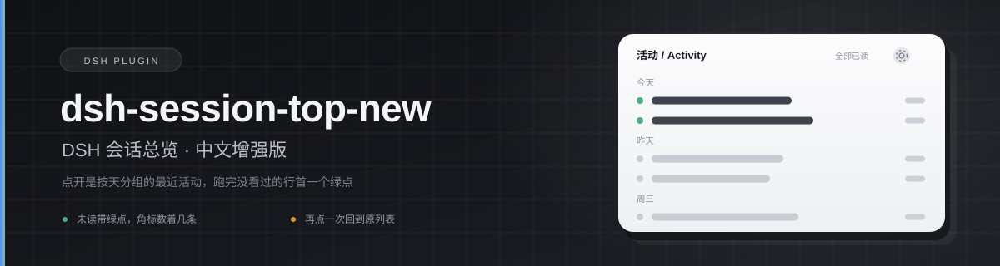
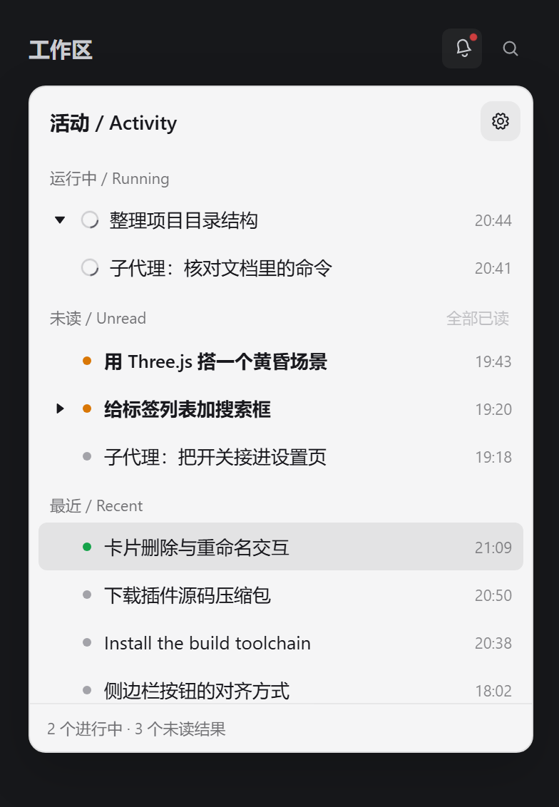
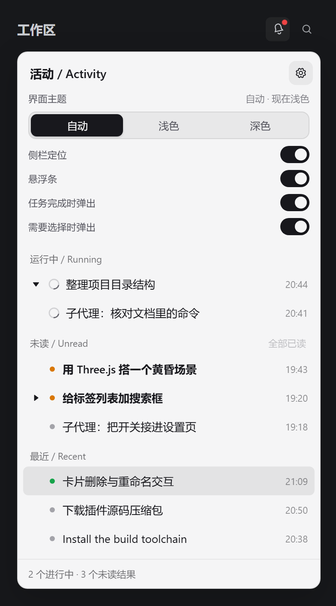
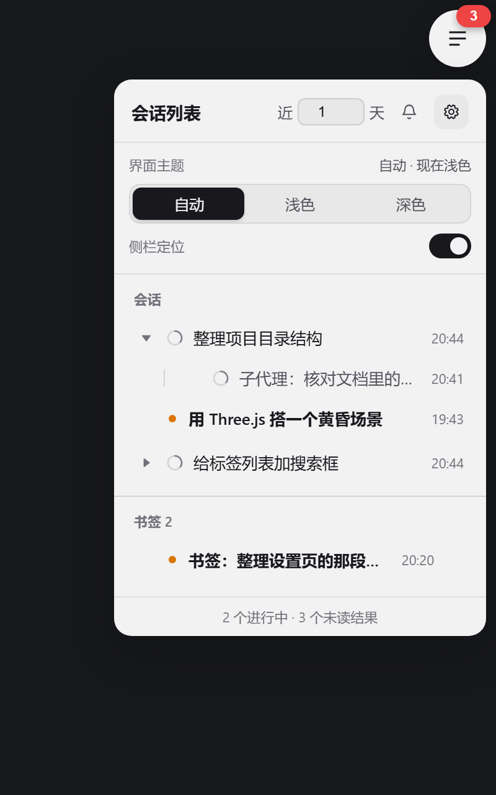
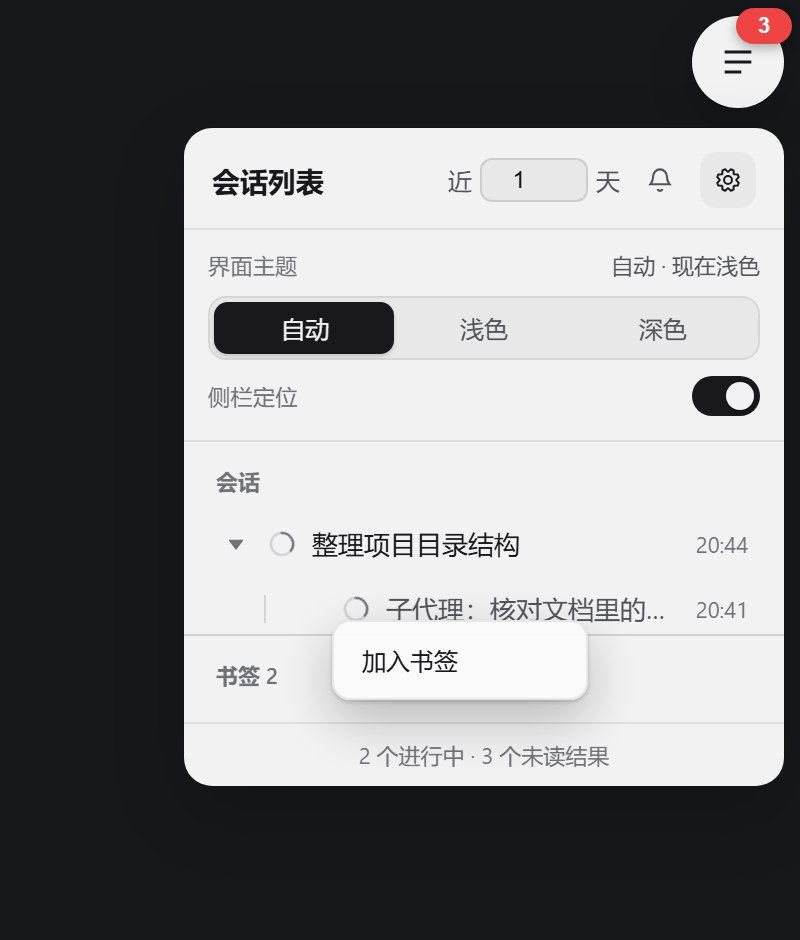

<div align="center">



**DSH 会话总览 · 中文增强版**

[](https://github.com/momoqiqi-qwq/dsh-session-top-new-plus/stargazers)   

</div>

<details open>
<summary><b>目录</b></summary>

- [可以做什么](#可以做什么)
- [演示](#演示)
- [侧栏定位](#侧栏定位)
- [下载与安装](#下载与安装)
- [v0.3.5 更新](#v035-更新)
- [兼容性与当前限制](#兼容性与当前限制)
- [实现方式](#实现方式)
- [源码运行与构建](#源码运行与构建)
- [上游与许可](#上游与许可)

</details>

---

# DSH 会话总览 中文增强版

**在侧栏放一颗铃铛，把运行中、未读和最近的会话摆在一起；点一下就跳过去。**

[项目介绍](#可以做什么) · [界面演示](#演示) · [版本记录](https://github.com/momoqiqi-qwq/dsh-session-top-new-plus/commits/main) · [反馈问题](https://github.com/momoqiqi-qwq/dsh-session-top-new-plus/issues)

> 本仓库是 [cuijiajun/dsh-session-top-new](https://github.com/cuijiajun/dsh-session-top-new) 的二改版本。
> 上游提供 DSH Web GUI 的会话悬浮条；这一版在它上面加了侧栏活动铃铛、
> 铃铛面板、主题与免打扰设置、侧栏定位、右键书签等一层中文向的增强。
> 插件 id 与包名仍是 `dsh-session-top-new`，与上游同一身份，装的就是同一个插件。
> 保留上游 MIT 许可与版权，未改动上游的许可证声明；上游原始说明见 [README.upstream.md](README.upstream.md)。

DeepSeek Harness 的会话列表一长，最新的一条和「还没看的那些」就一起沉下去了。
这个插件不重做侧栏，只在「工作区」标题行加一颗铃铛：
点开是运行中 / 未读 / 最近三段，行首标识与官方侧栏同一套，
点任意一条直接切过去；不想用铃铛，原来的悬浮条照旧。

## 可以做什么

- **侧栏一颗铃铛**：挂在「工作区 / Workspace」标题行，与搜索、筛选、新建同排，
  有未读时角标呼吸，侧栏收成窄轨时自动隐藏。
- **三段活动视图**：运行中 / 未读 / 最近分开列，子会话折叠在父会话下，需要时再展开。
  运行中的行是转圈，等你选择的行是琥珀点，结果没看过的行是实心点——和官方侧栏的判断顺序一致。
- **未读就是没看过**：点开某条会话的那一刻它就从「未读」掉到「最近」，
  不必等宿主自己把标记清掉；子会话有新动静会把父会话一起顶上来。
- **一键全部已读**：「未读」标题右边的「全部已读」把整组清空，不用一行一行点。
- **侧栏定位**：跳转之后，官方左侧边栏会滚到这条会话所在的行。细节见 [侧栏定位](#侧栏定位)。
- **主题自动反色**：浅色页面配深色面板、深色页面配浅色面板，默认跟随页面；
  齿轮里可以固定成自动 / 浅色 / 深色，固定后就不再随页面跳。
- **免打扰**：「任务完成时弹出」「需要选择时弹出」两个开关，各自独立，关掉的只是那一种提醒。
- **悬浮条可整块关掉**：铃铛设置里关掉「悬浮条」，那颗悬浮按钮就不再挂载——没有按钮、没有角标、没有拖拽区；
  铃铛列的仍是同一批会话，功能不丢，再打开时回到原来的位置。
- **右键加书签**：在悬浮条或铃铛里右键任意会话行选「加入书签」，它会进面板底部的书签区；
  一个会话只留一条，再次右键就是「移除书签」。这条路只依赖会话的 id 与标题，不猜 DOM，所以不会点不动。
- **沿用上游的悬浮条**：圆形按钮可拖到任意位置并按窗口比例记忆、近 N 天窗口（1–365）、
  父子折叠、悬停 ✕ 忽略该行（有新记录时自己回来）、贴边时面板朝另一侧展开、
  会话跑完响一声（Web Audio 合成，可静音）。

## 演示

### 铃铛面板



深色页面上的浅色面板。运行中的行在转圈，等你选择的行是琥珀点，
「未读」右边的「全部已读」一次清空；子会话默认折叠，展开时缩进在父会话下面。

### 铃铛设置



齿轮里是这一版的全部开关：界面主题（自动 / 浅色 / 深色）、侧栏定位、悬浮条、
任务完成时弹出、需要选择时弹出。

### 悬浮条



上游那颗悬浮条仍然在：标题行带「近 N 天」、静音与齿轮，下面是会话列表与书签区，
底部是「几个进行中 · 几个未读结果」。

### 右键书签



右键任意会话行，一个菜单、一个动作。书签按会话去重，重复加是替换。

## 侧栏定位

DSH 官方侧栏的会话树可能很长。你在铃铛面板或悬浮条里点一条会话，主视图切换过去之后，
左侧边栏原本停在别处——那一条还是看不见。这个开关补的就是这一步：
**跳转之后，官方侧栏会滚到这条会话所在的行，把它带到可见位置。**

- 位置：铃铛的齿轮设置 →「侧栏定位」，默认开启。
- 关掉之后：只切会话，侧栏不动。
- 状态存在 `localStorage` 的 `dsh-session-top-new.reveal` 下，悬浮条和铃铛共享同一个值。
- 边界：**只滚动，不展开折叠的项目分组**。那棵树是你自己摆的，为了滚一下去改它，比什么都不做更糟。
  找不到对应行时静默不动，不报错。

## 下载与安装

要求：DSH Web GUI（`web` profile）。

```bash
dsh plugin --profile web add github:momoqiqi-qwq/dsh-session-top-new-plus
```

装完 **重启 Web GUI**：客户端模块扫描会按启动缓存判定结果，新装的插件要重启才出现。
从源码安装时第一次会请求构建许可，照常确认即可。

升级同一个插件（在上游与本仓库之间切换也一样）：

```bash
dsh plugin --profile web remove dsh-session-top-new
dsh plugin --profile web add github:momoqiqi-qwq/dsh-session-top-new-plus
```

## v0.3.5 更新

| 版本 | 内容 |
| --- | --- |
| 0.3.5 | 右键会话加书签；修掉旧书签按钮「点了没反应」（不再靠 DOM 猜正文，读不到就用会话标题顶上） |
| 0.3.4 | 铃铛设置里新增「悬浮条」开关；修掉悬浮条设置区被列表压扁、开关被裁一半的问题 |
| 0.3.3 | 侧栏定位：跳转后官方侧栏滚到对应会话 |
| 0.3.2 | 行首标识与官方侧栏完全对齐（运行中、等你选择、未读结果、普通） |
| 0.3.1 | 齿轮与主题行的动效，让设置读起来像长在面板里而不是贴上去的 |
| 0.3.0 | 齿轮控制浅色 / 深色主题，默认自动反色 |
| 0.2.1 | 打开某条会话的那一刻把它移出「未读」 |
| 0.2.0 | 侧栏「工作区」标题行加活动铃铛；运行中 / 未读 / 最近三段面板；全部已读 |

## 兼容性与当前限制

- 只针对 **DSH Web GUI**。桌面端与 CLI 没有这套侧栏。
- 插件读的是官方 UI 自己也在用的客户端服务：`sessions.list`、`uiSession.sessionStatus`、
  `uiWorkspace.openSession`。它们不是冻结的公开 API，Harness 升级可能改名或改结构；
  真出问题时，控制台里会有一条 `[dsh-session-top-new]` 警告，而不是静默失效。
- 侧栏表头没有对外暴露的插槽（Slots 里没有 header actions 这一项），所以铃铛是**注入**进表头 DOM 的：
  找「工作区 / Workspace」（或「会话 / Sessions」）标签，往上找到同时放着几个控件的那一行，插在搜索控件之前。
  宿主改版换了表头结构时可能失配；失配只警告一次，悬浮条仍然可用。
- 侧栏定位只滚动、不展开折叠分组（见上文）。
- 面板与悬浮条的位置、主题、各开关状态存在 `localStorage`，跟着这台浏览器走。
- 测试针对 2026 年 10–11 月的 DSH 构建。

## 实现方式

| 用途 | 来源 |
| --- | --- |
| 会话列表与元数据 | `sessions.list`（`displayTitle`、`running`、`updatedAt`、`parentId`、`retainedBy.mainView`） |
| 运行中 / 未读状态 | `uiSession.sessionStatus`（`running`、`pendingInteraction`、`completionUnread`） |
| 跳到某条会话 | `uiWorkspace.openSession(id)` |
| 侧栏行定位 | 官方侧栏 DOM 中的会话行（按 id 匹配后 `scrollIntoView`） |

两个界面共用一份快照：`dock` 订阅上面两个数据源，抽出一层只含标量的扁平结构，
再交给悬浮条与铃铛；铃铛自己不再订阅宿主服务，只从这份快照里算分组和计数。
面板注册为第二个 `shell.overlay` 条目（`dsh-session-top-new-bell`），
**不替换** `sidebar.workspaces` 那块官方 UI。整个客户端 bundle 是手写的，没有构建步骤。

## 源码运行与构建

没有构建步骤，也没有运行时依赖需要安装：`lib/client.js` 是一份手写的 `__ModuleLoader__` bundle，
`require("react")` 也只用到 `React.createElement`。

```bash
git clone https://github.com/momoqiqi-qwq/dsh-session-top-new-plus
cd dsh-session-top-new-plus
node --check lib/client.js     # 语法
node tests/bell.cjs            # 生命周期、设置项与右键书签的断言（自带 DOM 替身，不需要浏览器）
```

文件结构：

```
dsh.plugin.json     插件清单（id / version / main / engines）
cordis.patch.yml    bundle 补丁：挂载宿主插件行
lib/index.js        宿主入口（no-op，存在是为了让 bundle 能挂上）
lib/client.js       悬浮条 + 侧栏铃铛：__ModuleLoader__ bundle（无构建）
tests/bell.cjs      节点断言，自带 DOM 替身
assets/             演示图与 hero
screenshots.json    上架用的截图清单
```

## 上游与许可

本仓库是社区二改版，与上游独立发行。上游 [cuijiajun/dsh-session-top-new](https://github.com/cuijiajun/dsh-session-top-new)
提供了整套悬浮条与它的数据层，这一版的所有增强都长在它上面——谢谢原作者。
两边都遵循 [MIT License](LICENSE)，保留原作者的版权声明；上游原始说明见 [README.upstream.md](README.upstream.md)。

遇到问题请提到[本仓库的 issues](https://github.com/momoqiqi-qwq/dsh-session-top-new-plus/issues)，
上游行为本身的问题也可以直接找 [上游](https://github.com/cuijiajun/dsh-session-top-new/issues)。
